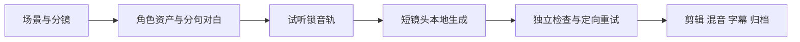

<div align="center">

# LocalVideo

**把 AI 短片从「一次抽卡」变成「一条能重跑的本地流水线」。**

各种本地模式制作视频的流程与技能：**Wan2.2 · 多角色自然对白 · ComfyUI · FreeVideo · Blender · FFmpeg**。

[资源下载与配置总表](docs/RESOURCES.md) · [模型与文件精确版本](configs/models.json) · [贡献](docs/CONTRIBUTING.md)

**装之前先看：[各模型磁盘占用](docs/MODEL_STORAGE.md)**。主线五文件约 **23.43 GiB**，另计环境、热副本与输出；磁盘大小与显存要求分开记录。

[English](README.en.md) · [安装](docs/INSTALL.md) · [工作流](docs/WORKFLOW.md) · [对白](docs/DIALOGUE.md) · [模型](docs/MODELS.md) · [性能](docs/PERFORMANCE.md) · [排错](docs/TROUBLESHOOTING.md) · [复现](docs/REPRODUCIBILITY.md) · [隐私](docs/PRIVACY.md) · [第三方许可](THIRD_PARTY_NOTICES.md)

</div>

面向本地 AI 短片 / 短剧开发者：一套可复用的「视频 + 多角色对白」制作流程，包含 Agent 技能、ComfyUI 调度、FFmpeg 合成，以及性能与 QC 记录。仓库提供通用流程源码、技能、JSON 模板和文档。

## 为什么用它

生成一条视频不难，难的是坏了之后知道坏在哪、敢不敢重跑。

- **按阶段拆开**：每个环节有名字、有产出、有记录，出问题能定位到具体一步。
- **重试只重做坏镜头**，不必整段推倒重来。
- **不按「5 分钟一条」做推理排期**，而是把冷启动、采样、解码、剪辑分别计时，时间花在哪看得见。
- **单 GPU 队列**顺序执行，本地可控、输入与每一版产物有据可查。

## 你能得到什么

主线：输入 → 口语场景剧本 → 结构分镜 → 角色 / 场景一致性 → 分句 CosyVoice2 → 听审锁音轨 → 5–10 秒 Wan2.2-S2V 镜头 → 独立 QC → FFmpeg 剪辑 / 字幕 / 混音 → 归档。

其中「听审锁音轨」是流程的关键：先把声音定下来、审过、锁住，再让画面去对齐它，而不是让对白追着画面跑。

仓库**不含**私人照片、克隆声线、小说内容、成片、模型权重和密钥。

## 路线状态

| 路线 | 状态 | 说明 |
| --- | --- | --- |
| Wan2.2-S2V | 主要执行路径 | 5–10 秒镜头，逐镜头 QC |
| FreeVideo / H3 二采 / guide | 实验流程 | 可跑通，尚未定型 |
| SVD | 受限可选 | 静音 I2V，仅适合轻动作 |
| LTX 原生 AV | 可运行，未通过 | 历史测试的伪字幕 / 闭口问题仍在 |
| ContentV 官方接口 | 受限 | 仅 T2V，不支持指定参考图 / 音频条件 |
| Blender / Cycles / Eevee | 脚本控制路线 | 由脚本驱动，不是生成模型 |
| LivePortrait / MuseTalk / LatentSync | 可选局部动画 / 对口型 | 不保证身份一致，也不保证静听自然 |
| 音乐工具 | 可选 | 不参与主线判定 |

上表不等于「这些全部生产可用」。它是现状记录，不是承诺。

## 三步 CPU 快跑

```bash
python -m pip install -e .
localvideo doctor
localvideo demo --work /absolute/new-demo
```

CPU demo 只包含确定性测试卡和测试音，用来验证环境、文件、字幕与合成链路是否打通，**不代表** AI 生成质量，也不代表自然对白。

## 真实 AI 入口

真实生成需要按 `docs/INSTALL.md` 准备独立的 GPU 环境，下载并遵守各自许可的模型权重，并自备合法的参考图片与语音素材。

## Agent 技能

- `skills/local-ai-video-production`
- `skills/wan22-s2v-local-production`
- `skills/scene-dialogue`

可直接复制进你自己的 Codex 技能目录。涉及对白的环节请务必使用 `scene-dialogue`。

保留源码克隆并设置 `LOCALVIDEO_HOME` 指向它；安装技能不等于安装GPU模型环境。可这样下达任务：

> 使用 `$local-ai-video-production` 和 `$scene-dialogue`，用我已授权的参考素材，先做5秒本地样片，记录各环节耗时并独立质检，通过后再扩批。



## 实测边界

本机历史测过 RTX 5060 Ti 16GB、32GB RAM。Wan scaled FP8 + 4 步 LCM/LightX2V、16fps、832x480 属于历史特定组合，**不保证**在任意机器上复现同等耗时。安全模式与优化模式分别记录，不混为一谈。CPU 权重复用 hook 是版本绑定的实验组件，更换模型版本后需要重新验证。

## 隐私与贡献

素材自己出、流程自己跑、文件留在本地。MIT 只覆盖本仓库自有代码；上游模型与工具遵从各自许可，详见 `THIRD_PARTY_NOTICES.md`。
